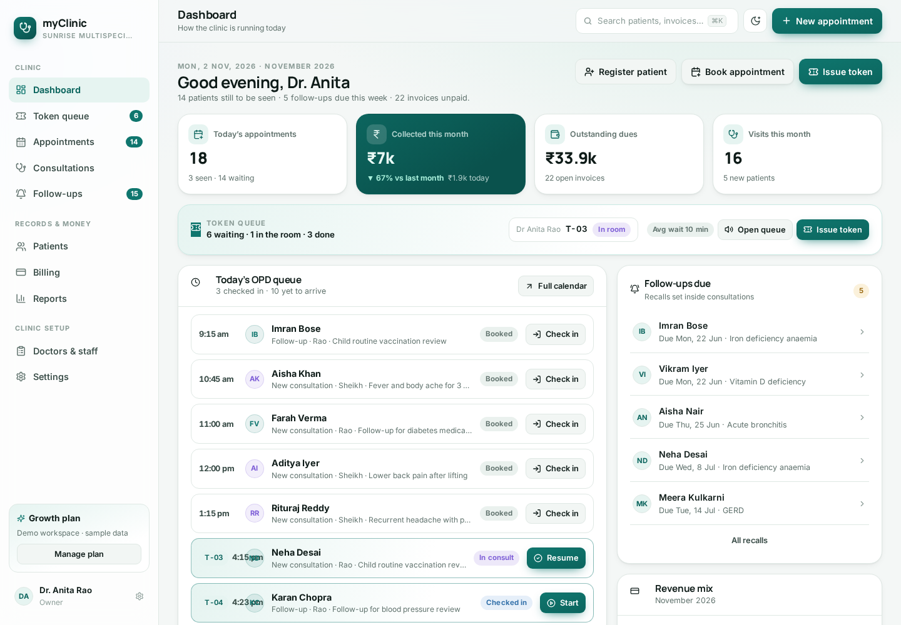
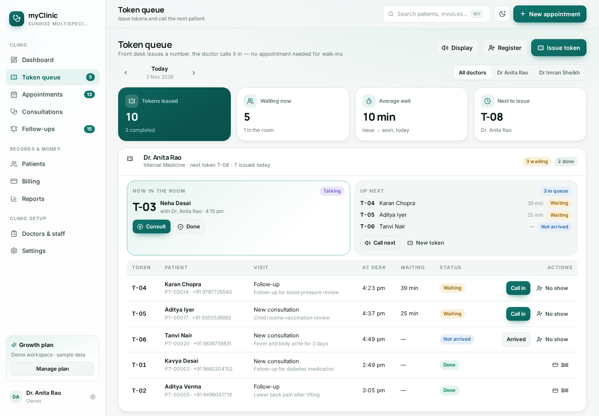
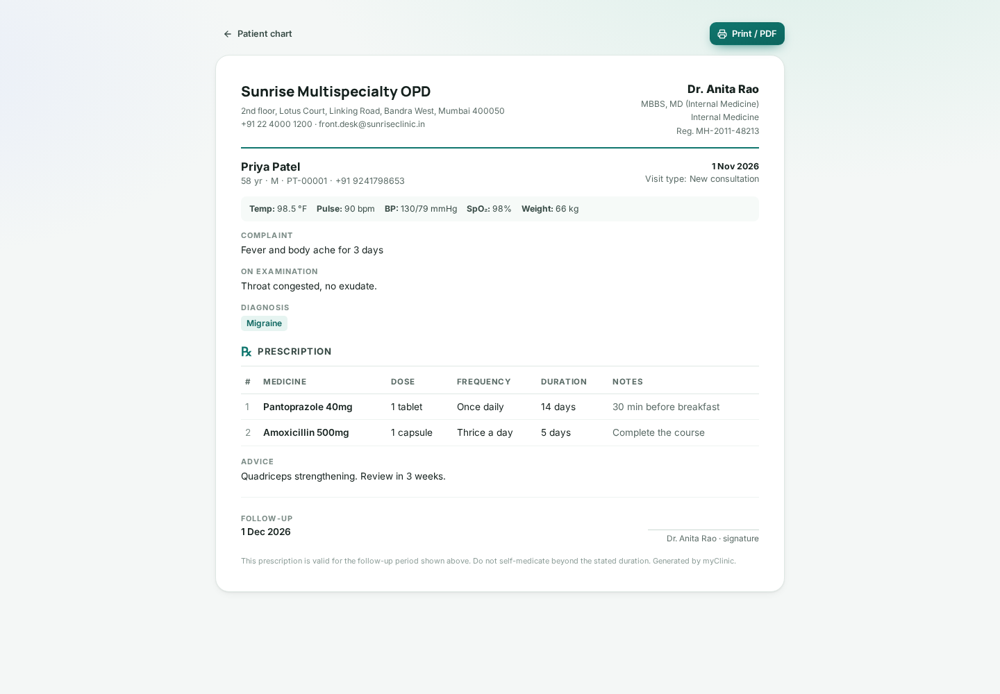
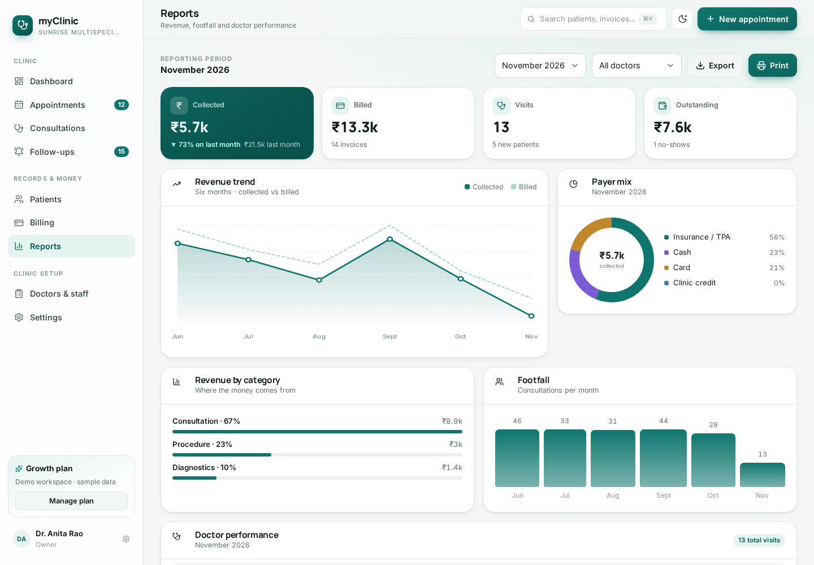
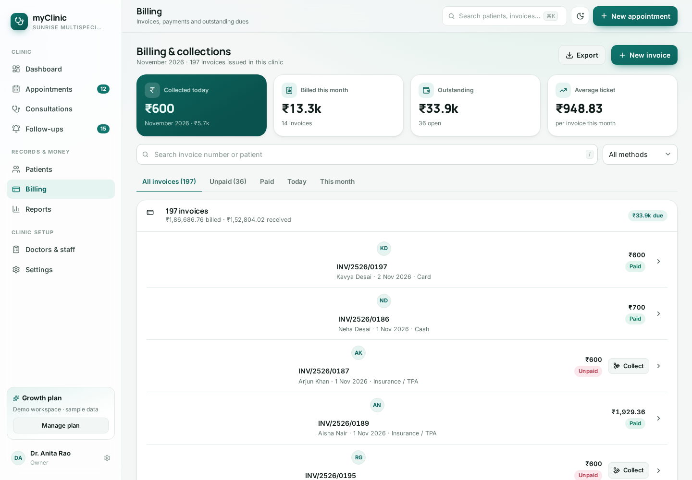
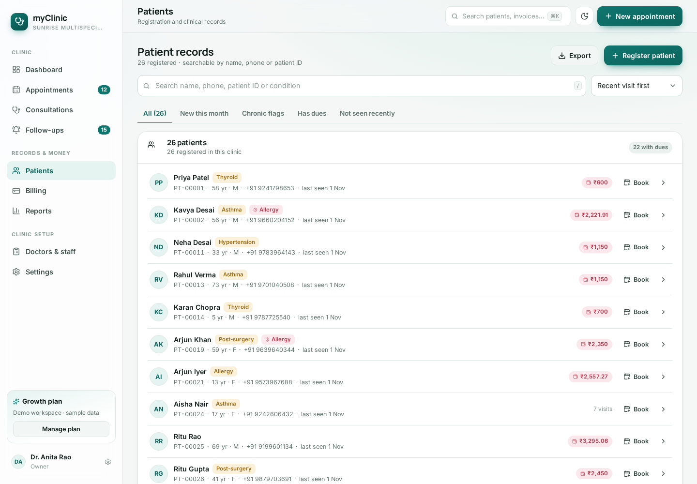
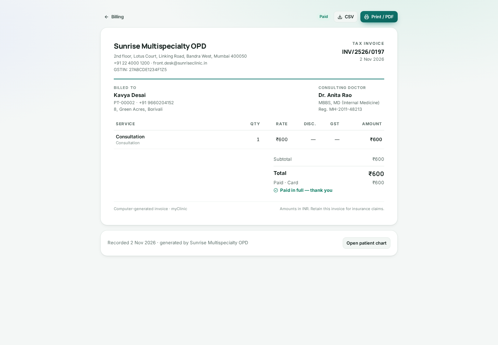
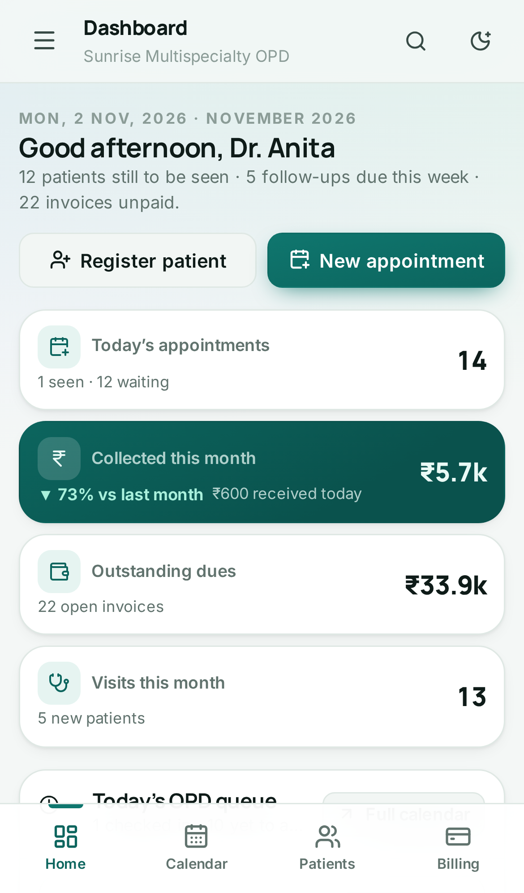
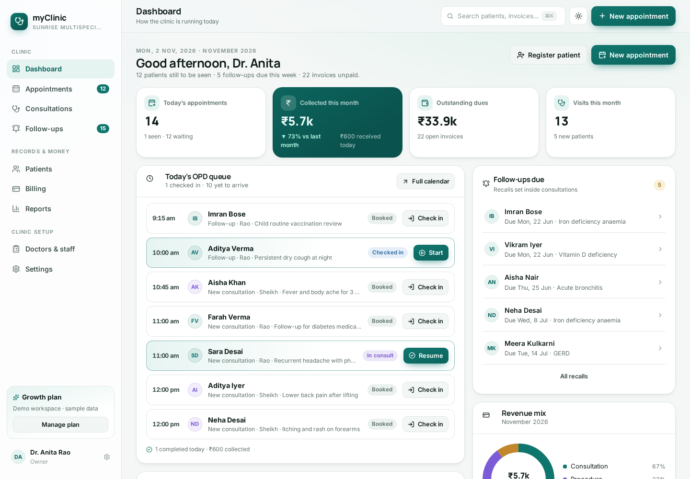
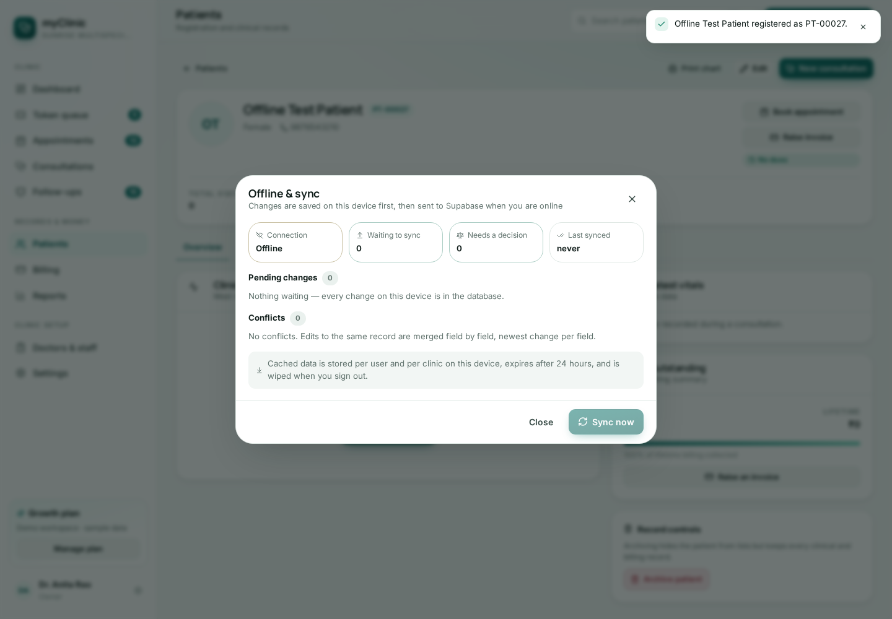

<div align="center">
  
  <h1>myClinic</h1>
  <p><strong>OPD management software for clinics that run on a queue and a bill.</strong></p>
  <p>Appointments, public booking, token queue, patient records, consultations, prescriptions, GST billing, day close and follow-ups — one installable web app, offline-first, built for the Indian clinic desk.</p>

  <p>
    <a href="https://github.com/rajeshlande/myClinic/actions/workflows/ci.yml"></a>
    <a href="https://github.com/rajeshlande/myClinic/actions/workflows/pages.yml"></a>
    
    
    <a href="LICENSE"></a>
  </p>

  <p>
    <a href="https://rajeshlande.github.io/myClinic/"><strong>Live demo</strong></a> ·
    <a href="CHANGELOG.md">Changelog</a> ·
    <a href="docs/SUPABASE-SETUP.md">Setup guide</a> ·
    <a href="CONTRIBUTING.md">Contributing</a>
  </p>
</div>



## Table of contents

- [Why myClinic](#why-myclinic)
- [Quick start](#quick-start)
- [Screenshots](#screenshots)
- [Features](#features)
- [Roles and permissions](#roles-and-permissions)
- [Plans and subscription](#plans-and-subscription)
- [Built with](#built-with)
- [Project structure](#project-structure)
- [Configuration](#configuration)
- [Database and migrations](#database-and-migrations)
- [Testing](#testing)
- [Deployment](#deployment)
- [Troubleshooting](#troubleshooting)
- [Documentation](#documentation)
- [Versioning](#versioning)
- [Contributing](#contributing)
- [License](#license)

## Why myClinic

A clinic's day runs on one queue and one bill. Most software makes the receptionist
fight the software to get there. Three constraints shaped every screen:

- **The queue is the day.** Tokens, check-in, "in consult", "done" — and the day
  board is interval-accurate, so a 30-minute visit occupies 30 minutes of the
  doctor's morning.
- **Money is integer paise, everywhere.** No floating-point rupees and no rounding
  drift between the consultation, the invoice, the day close and the report.
- **The server is the authority.** Roles, seat limits and the read-only gate are
  Postgres policies and triggers, not hidden buttons. The client mirrors those
  rules so it never offers an action the server would reject.

## Quick start

Runs in **demo mode** with six months of fictional clinic data — no account, no
configuration, no Supabase project:

```bash
git clone https://github.com/rajeshlande/myClinic.git
cd myClinic
npm ci
npm run dev        # http://localhost:5173
```

To connect a real clinic, add two keys and apply the database:

```bash
cp .env.example .env.local     # VITE_SUPABASE_URL, VITE_SUPABASE_ANON_KEY
# paste supabase/schema.sql into the Supabase SQL editor (whole file, once)
```

Requirements: **Node 26 LTS** (pinned in `.nvmrc`; anything ≥ 22.22 works) and
**npm 12.2.1**.

| Command | What it does |
|---|---|
| `npm run dev` | Dev server on `0.0.0.0:5173` |
| `npm run build` | Production bundle in `dist/` |
| `npm test` | 286 unit tests across 13 suites |
| `npm run check:pages` | Proves the bundle is deployable as-is |
| `npm run check:key` | Is a licence public key usable — and are two of them the same key |
| `npm run verify` | `test` + `build` + `check:pages` — the gate CI runs |

## Screenshots

| Front desk | Doctor | Owner |
|---|---|---|
|  |  |  |
|  |  |  |

| On a phone | Dark theme | Offline |
|---|---|---|
|  |  |  |

## Features

**Front desk** — token queue for walk-ins; interval-accurate day board per doctor,
week load and next-free suggestion; patient registration with auto codes
(`PT-00001`), phone-digit dedupe and clinical flags; GST-ready invoices with line
items, discounts, part payments and a scannable **UPI QR** on every unpaid bill;
reminders with a send log that honours quiet hours; and **WhatsApp on the desk's own
number** — token, appointment, bill and prescription — from one composer that shows the
exact text, respects a patient's opt-out, and writes what was sent to the log.

**Doctor** — consultations with vitals, examination, diagnoses and advice; a
typo-tolerant drug typeahead (starter formulary + an importable brand directory) that fills dose, frequency and duration and runs safety
checks; print-ready prescriptions in ten Indian languages with `RX/<fy>/<seq>`
numbering; follow-up lists that close the loop.

**Owner** — revenue, payer mix, footfall, appointment outcomes and doctor
performance; a public booking page at `/#/book/<clinic-slug>` that sells the same
slots the front desk sees, with a `BK-…` reference a patient can cancel with;
**two sessions a day** (9 AM–1 PM and 6 PM–10 PM, with the break between them never
offered as a slot), a doctor who sits inside one of them, **days off** for the clinic
and for each person, and a follow-up window of 3–45 days; doctors and staff with their
own hours, fees and calendar colour; email invitations claimed on first sign-in; day
close with cash reconciliation, missed charges and a frozen snapshot per day.

**Platform** — offline-first with an outbox and a sync centre that never merges a
clinician's edit silently; multi-tenant by RLS; one set of breakpoints with a
bottom tab bar on phones; installable PWA; and saves that say what went wrong —
a missing column names itself and points at `supabase/schema.sql`, a refused seat,
an expired session, an unreachable server and a rejected value each read differently,
with the last few failures listed under Settings → About.

## Roles and permissions

Three seats, one table — printed on the Team page, enforced by the nav, the
routes, the screens **and** the database (schema 13).

| Capability | Owner | Doctor | Front desk |
| --- | :--: | :--: | :--:|
| Dashboard & reports | ✓ | ✓ | ✓ |
| Patient charts | ✓ | ✓ | ✓ |
| Consultations & prescriptions | ✓ | ✓ | — |
| Billing & payments | ✓ | — | ✓ |
| Message a patient on WhatsApp | ✓ | ✓ | ✓ |
| Day close & reconciliation | ✓ | — | — |
| Staff roster | ✓ | ✓ | — |
| Clinic settings, plan & staff changes | ✓ | — | — |

Where each row is enforced:

| Layer | Mechanism |
|---|---|
| Screens | `can(role, capability)` from `src/lib/permissions.js` drives every button, tab and section — including which settings tabs exist for a seat. |
| Routes | `<RequireCapability>` in `src/App.jsx` redirects a role that cannot open a page instead of showing a dead screen. |
| Database | `consultations_read` = owner + doctor; `invoices_read/_write/_update` = owner + front desk; staff changes guarded by policies and the `staff_guard()` trigger. |
| Numbers | A role without consultation access still sees its footfall: totals fall back to completed appointments, so the desk never reads a real day as an empty one. |

`tests/rbac.test.mjs` fails the build if the capability map, the routes and the
SQL role lists drift apart.

## Plans and subscription

| Plan | Monthly | Yearly (2 months free) | Doctors | Front desk | Branches |
|---|---|---|---|---|---|
| Solo | ₹999 | ₹9,590 | 1 | 1 | 1 |
| Growth | ₹2,499 | ₹23,990 | 5 | 3 | 1 |
| Multi-clinic | ₹5,999 | ₹57,590 | unlimited | unlimited | unlimited |

Lifecycle: **14-day trial** → **active** → **7-day grace** after the period ends
(writes still work, with a banner) → **read-only**. No card processing happens in
the app: a payment is recorded against a UPI / bank / reseller reference, and the
term is always the subscription's own interval — a yearly clinic renews for twelve
months. Only the owner sees the plan panel or can change it.

What licensing never does: hold data hostage (expired clinics read and export
everything), delete anything (lapsing pauses writes), or trust the client (seat
limits and the write gate are Postgres triggers and RLS).

## Built with

| Layer | Choice |
|---|---|
| UI | React 19, React Router 8 (hash routing), hand-written CSS |
| Build | Vite 8 |
| Data | Supabase — Postgres, Auth, row-level security |
| Icons | lucide-react |
| QR | qrcode-generator (UPC/UPI QR encoded locally, nothing sent to a service) |
| Tests | `node --test`, plus SQL suites run against a real PostgreSQL |

## Project structure

```text
src/
  App.jsx                 routes and capability guards
  lib/
    logic.mjs             pure domain logic: money, invoices, slots, totals, reports
    daybook.mjs           day close: totals, missed charges, reconciliation
    license.mjs           plans, prices, trial/grace/read-only, billing period
    permissions.js        the capability matrix: one source for UI and tests
    store.jsx             the single data store (live Supabase or demo mode)
    offline.js            cache, outbox, conflict resolution
    demo-data.js          six months of fictional clinic data
  pages/                  one file per screen
  components/             forms, layout, charts, document shells
supabase/
  schema.sql              the whole database: tables, policies, functions, migrations 1→18
  schema-tests.sql        fourteen rolled-back SQL suites
tests/                    286 unit tests across 13 suites
docs/                     setup, security, dependency and gap analysis
scripts/                  check-pages.mjs, security-check.mjs
```

## Configuration

Copy `.env.example` to `.env.local`. Only **public** values belong in a `VITE_`
variable.

| Variable | Required | Purpose |
|---|---|---|
| `VITE_SUPABASE_URL` | live mode | `https://<ref>.supabase.co` |
| `VITE_SUPABASE_ANON_KEY` | live mode | Publishable / anon key. **Never** a service-role key. |
| `VITE_BASE` | no | Force an absolute asset base; leave empty for relative assets. |

Missing keys are not an error: the build runs in demo mode and says so in the
deploy log.

## Database and migrations

`supabase/schema.sql` is the whole database, and it is **idempotent and
additive** — run it whole, as often as you like, and it applies only the blocks you
are missing.

```bash
psql "$DATABASE_URL" -v ON_ERROR_STOP=1 -f supabase/schema.sql    # migrate
psql "$DATABASE_URL" -v ON_ERROR_STOP=1 -f supabase/schema-tests.sql  # prove it
```

Current schema level: **18**, exposed by `app_schema_version()`. The app warns
when the database is behind it, and every upgrade path is exercised before a
release — a fresh install and an N → N+1 upgrade, both followed by the SQL suites.

Rules that never change: every tenant row carries `clinic_id` and policies read it
(never a client claim); ids are `uuid`, codes (`PT-…`, `INV/…`, `RX/…`) are minted
server-side; money is `bigint` paise; timestamps are `timestamptz`.

## Testing

```bash
npm run verify                 # unit tests, build, deployability
node scripts/security-check.mjs
```

| Gate | Scope |
|---|---|
| `npm test` | **482 tests / 23 files** — domain logic, day book, licensing, RBAC, invites, medicines, drug search and import, payments, public booking, the offline cache and its expiry, the licence authority (real RS256 signatures), replay, responsive breakpoints, landing-page promises, schema-shaped guards. |
| `supabase/schema-tests.sql` | **Thirteen SQL suites** in rolled-back transactions: RLS role matrix, licensing, public booking, slug handling, booking links, role split and self-promotion, hours, profiles, the drug directory and drug search at scale, investigations, the audit fixes (schema 17) and the licence authority (schema 18). |
| CI (`.github/workflows/ci.yml`) | Node 22 and 26, tests, build, Pages readiness, sub-path build, security checklist, `npm audit --audit-level=high`. |

SQL is never shipped unverified: it is applied to a real PostgreSQL 17 and the
suites run against it.

## Deployment

GitHub Pages, driven by `.github/workflows/pages.yml` on every push to `main`
(and on `workflow_dispatch`):

1. **Settings → Secrets and variables → Actions**: add `VITE_SUPABASE_URL` and
   `VITE_SUPABASE_ANON_KEY` (optional — without them the deploy is a demo build).
2. **Settings → Pages → Build and deployment → Source: GitHub Actions**.
3. Push to `main`. The workflow tests, builds, checks the bundle, adds a `404.html`
   fallback and deploys.

The site lives at `https://<owner>.github.io/<repo>/`. Assets are relative, so a
project page, a custom domain and `localhost` all work from the same build.
`/#/setup` is the in-app self-test: environment, schema version, RLS, and what this
build expects.

## Troubleshooting

| Symptom | Cause and fix |
|---|---|
| Pushed to `main`, no deploy ran | GitHub Actions was degraded, or the run was never created. **Actions → Deploy to GitHub Pages → Run workflow**; check `githubstatus.com`. |
| The app says the schema is behind | Paste `supabase/schema.sql` into the SQL editor, whole file. It is additive; nothing is lost. |
| `WhatsApp` is greyed out for one patient | They are marked as opted out (schema 11) or the number is unusable — the composer says which. The opt-out is on the patient card. |
| A message went twice | The composer flags "already sent today" from the log but does not block it; the log is the record. |
| A doctor cannot open Billing, or the desk cannot open Consultations | Intended since schema 10 — see [Roles and permissions](#roles-and-permissions). Move the person to the seat that owns the job. |
| The front desk has no Day close or Doctors & staff | Also intended: those are the owner's reconciliation and roster screens. Only the owner sees the plan panel. |
| Booking link 404s | The clinic has no slug. Schema 9 backfills it; **Settings → Clinic → Public booking → Save** mints one. |
| Demo data looks stale | **Settings → Plan & data → Reset demo workspace**. |
| Deploy builds but shows demo mode | The two Supabase secrets did not reach the build; the deploy log names the missing one. |

## Documentation

| Document | Contents |
|---|---|
| [`docs/SUPABASE-SETUP.md`](docs/SUPABASE-SETUP.md) | Project creation, redirect URLs, secrets, deploy, self-test. |
| [`docs/SECURITY.md`](docs/SECURITY.md) | Threat model, findings and their remediation status. |
| [`SECURITY.md`](SECURITY.md) | How to report a vulnerability, privately. |
| [`CONTRIBUTING.md`](CONTRIBUTING.md) | Setup, conventions, and what must never regress. |
| [`CHANGELOG.md`](CHANGELOG.md) | Every release, with the schema version it needs. |
| [`PUSH.md`](PUSH.md) | How this repository hands over releases as git bundles. |
| [`docs/PRODUCT-GAP-ANALYSIS.md`](docs/PRODUCT-GAP-ANALYSIS.md) | What is deliberately **not** built yet, and why. |
| [`THIRD_PARTY_NOTICES.md`](THIRD_PARTY_NOTICES.md) | Dependencies and licences. |

## Versioning

Two numbers travel together and must not be confused:

- **App version** (`package.json`, `src/lib/version.js`) — semantic, e.g. `1.11.9`.
- **Schema version** (`app_schema_version()`) — a migration level. A release that
  needs a new one says so in its changelog entry and in the app.

Every release: `npm run verify` green, SQL applied to a real Postgres, a test for
whatever was fixed, `CHANGELOG.md` updated, a git tag, and the database
instruction the operator needs.

## Contributing

Read [`CONTRIBUTING.md`](CONTRIBUTING.md) first. Two rules outrank style: **never
break tenant isolation**, and **never lose a clinician's concurrent edit**. New
behaviour comes with a test; a change to SQL comes with a suite in
`supabase/schema-tests.sql`.

The standards are checked, not remembered:

```bash
npm run check:contributing   # 28 rules: secrets, dependencies, cleanups, naming, versions, docs
npm run audit:security       # the same, plus npm audit, and warnings fail too
```

A coding agent opened on this repository also loads the vendored
[Cloudflare `security-audit` skill](.claude/skills/security-audit/SKILL.md) — ask it
for a security review and it audits with independently verified findings.

## License

MIT — see [`LICENSE`](LICENSE).
